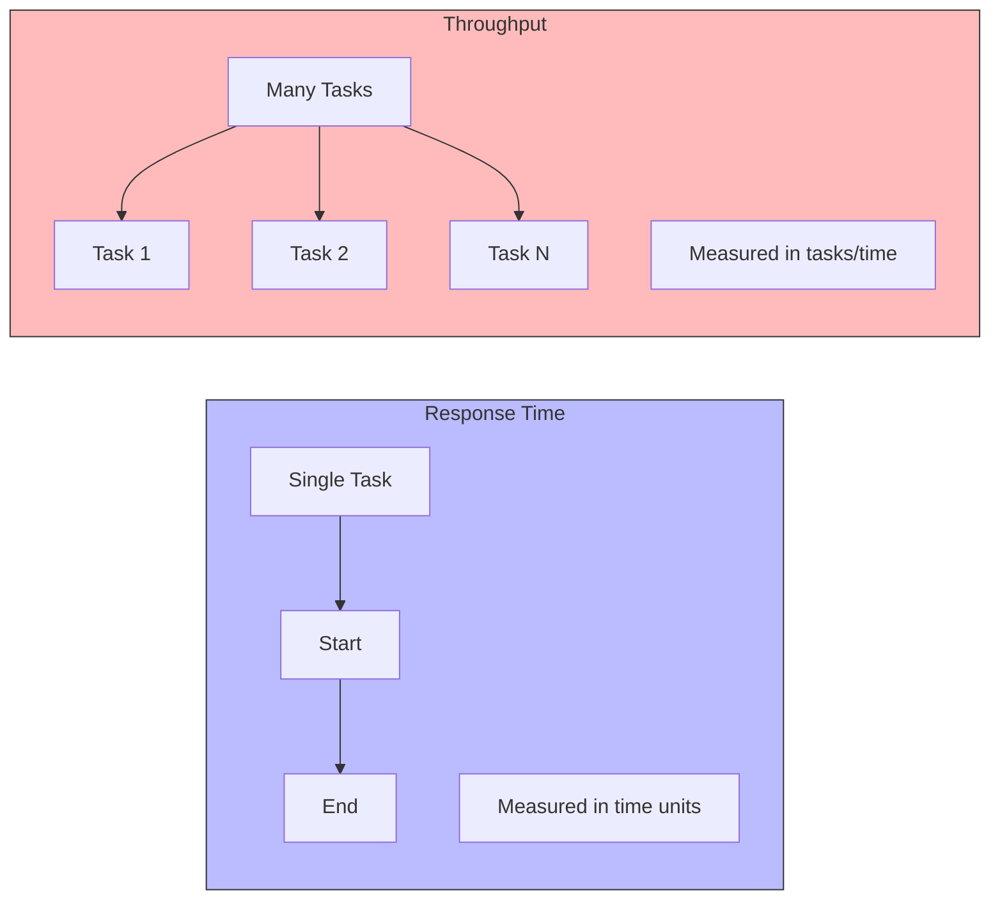
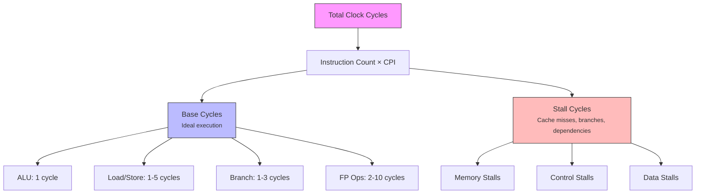
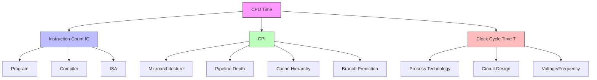
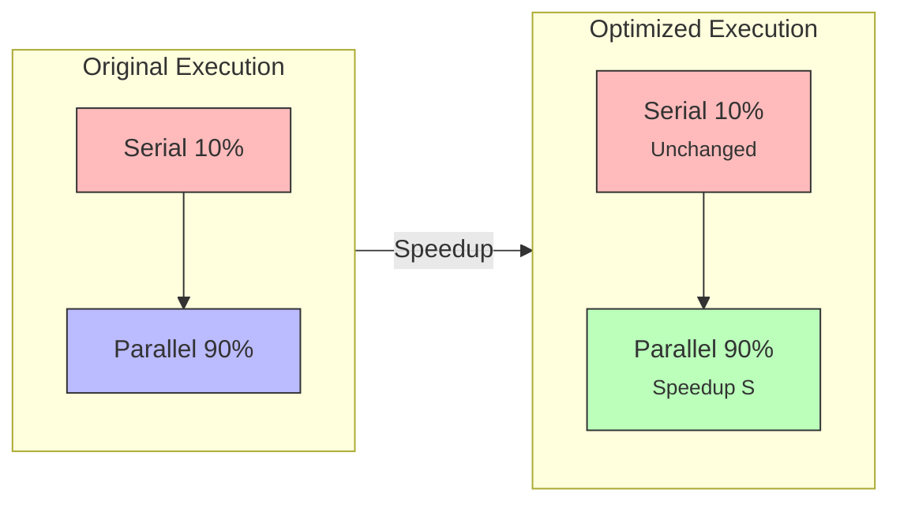
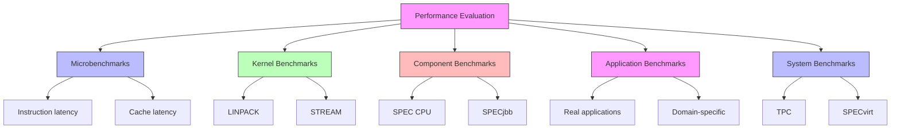
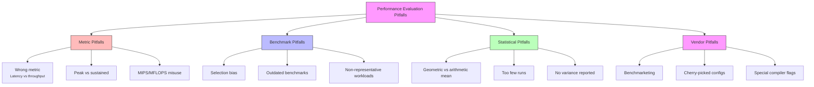

# Chapter 2: Performance Measurement & Metrics

> A detailed guide to understanding how computer performance is defined, measured, and evaluated — covering fundamental metrics, the CPU performance equation, Amdahl's Law, and benchmarking methodologies.

---

## 2.1 Defining Performance: Response Time vs. Throughput

Performance is not a single, universal number — it depends entirely on **what you're measuring** and **why**. In computer architecture, two fundamental perspectives dominate.

- **Response Time (Execution Time / Latency):** The total time required to complete a single task — from request to result. Measured in seconds, milliseconds, or nanoseconds. Focuses on **how fast one thing gets done**. *Examples: time to render a frame, database query latency, compile time.*
- **Throughput (Bandwidth):** The total amount of work completed per unit of time. Measured in tasks/second, transactions/minute, bytes/second. Focuses on **how much gets done overall**. *Examples: web requests served per second, FPS in animation, instructions retired per cycle (IPC).*

**Key Distinction:** Response time answers *"How long for one task?"* while throughput answers *"How many tasks per unit time?"* They are **not the same** and can move in opposite directions.

**The Pipelining Example:**
- Splitting instruction execution into 5 stages means each instruction still takes 5 cycles (response time unchanged)
- But a new instruction finishes **every cycle** once the pipeline is full (throughput dramatically improved)

**The Multi-Core Example:**
- Adding more cores increases throughput (requests/sec)
- Response time for a *single* request may not improve, and may worsen due to cache contention and synchronization overhead

**Comparison Diagram:**


> **Key Takeaway:** Always clarify which metric matters for the workload. A system optimized for throughput can be worse for latency-sensitive applications, and vice versa.

---

## 2.2 CPU Execution Time: Clock Cycles, Clock Rate, and CPI

To measure and compare CPUs rigorously, we break execution time into measurable components.

### The Clock

Modern processors are synchronous — they operate on a **clock signal** that ticks at a fixed frequency.

- **Clock period (T):** Duration of one clock tick (e.g., 0.25 ns)
- **Clock rate / frequency (f):** Ticks per second (e.g., 4 GHz = 4 × 10⁹ ticks/sec)
- **Relationship:** `T = 1 / f`

Example:
```
f = 4 GHz  →  T = 1 / (4 × 10⁹) = 0.25 ns
f = 3 GHz  →  T = 1 / (3 × 10⁹) ≈ 0.333 ns
```

Higher clock rate → shorter clock period → potentially faster execution (but not guaranteed — see CPI).

### Clock Cycles

A program's execution consumes a certain number of **clock cycles**. This depends on:
1. The number of instructions executed
2. How many cycles each instruction takes

```
Total cycles = Σ (cycles per instruction × number of times executed)
```

### CPI (Cycles Per Instruction)

**CPI** is the average number of clock cycles each instruction takes to execute.

```
CPI = Total Clock Cycles / Instruction Count
```

**Why "average"?** Different instructions take different numbers of cycles:

| Instruction Type | Typical Cycles |
|-----------------|----------------|
| Simple ALU (add, sub) | 1 |
| Load / Store | 1–5 (depending on cache hit/miss) |
| Branch | 1–3 |
| Multiply | 3–5 |
| Divide | 20–40 |
| Floating-point ops | 2–10 |

**Example calculation:**

Suppose a program has:
- 1,000,000 instructions
- 400,000 are loads (2 cycles each)
- 500,000 are ALU ops (1 cycle each)
- 100,000 are branches (3 cycles each)

```
Total cycles = (400,000 × 2) + (500,000 × 1) + (100,000 × 3)
             = 800,000 + 500,000 + 300,000
             = 1,600,000 cycles

CPI = 1,600,000 / 1,000,000 = 1.6
```

### Ideal vs. Actual CPI

- **Ideal CPI:** Best case, assuming perfect pipelining (often 1 for a scalar pipeline)
- **Actual CPI:** Includes stalls from cache misses, branch mispredictions, dependencies, resource conflicts

```
Actual CPI = Ideal CPI + Stall cycles per instruction
```

> **Note:** CPI is *not* a fixed property of a CPU. It varies by program, compiler, and input data. Comparing CPUs by CPI alone is misleading.

**CPI Breakdown Diagram:**


---

## 2.3 The CPU Performance Equation

This is the **single most important formula** in computer performance analysis. It ties together everything from Section 2.2.

### The Equation

```
CPU Time = Instruction Count (IC) × CPI × Clock Cycle Time
```

Or equivalently, using clock rate:

```
CPU Time = (IC × CPI) / Clock Rate
```

### Breaking Down Each Term

| Term | Symbol | Depends On | Affected By |
|------|--------|-----------|-------------|
| Instruction Count | IC | Program, compiler, ISA | Algorithm choice, compiler optimization, ISA design |
| Cycles Per Instruction | CPI | CPU microarchitecture, program behavior | Pipelining, caches, branch prediction, ILP |
| Clock Cycle Time | T | Hardware technology, circuit design | Process node, voltage, pipeline depth |
| Clock Rate | f = 1/T | Same as above | Same as above |

### Why This Equation Matters

It tells you that **three independent factors** determine performance — and improving one may worsen another:

- **Deeper pipelines** → shorter clock cycle time (higher f), but higher CPI (more stalls, more branch penalty)
- **More complex instructions** → fewer instructions (lower IC), but higher CPI and possibly longer cycle time
- **Better compiler** → fewer instructions (lower IC), but CPI may stay the same

### Worked Example

**Problem:** Compare two CPUs running the same program.

| Parameter | CPU A | CPU B |
|-----------|-------|-------|
| Clock Rate | 2.5 GHz | 3.0 GHz |
| CPI | 1.5 | 2.0 |
| Instruction Count | 10⁹ | 10⁹ |

**Solution:**

```
CPU A time = (10⁹ × 1.5) / (2.5 × 10⁹) = 1.5 / 2.5 = 0.6 seconds
CPU B time = (10⁹ × 2.0) / (3.0 × 10⁹) = 2.0 / 3.0 ≈ 0.667 seconds
```

**Result:** CPU A is faster despite having a *lower* clock rate — because its CPI is better.

### Performance Comparison

If we want to express how much faster one machine is:

```
Performance = 1 / Execution Time

Speedup = Performance_A / Performance_B
        = Execution_Time_B / Execution_Time_A
```

In the example above:

```
Speedup of A over B = 0.667 / 0.6 ≈ 1.11×
```

CPU A is about 11% faster than CPU B.

**Performance Equation Diagram:**


> **Lesson:** Clock rate alone is a poor performance indicator. Always consider IC, CPI, and clock rate together.

---

## 2.4 Amdahl's Law

Amdahl's Law describes the **fundamental limit** on how much a system can be improved by optimizing only part of it.

### The Formula

```
Speedup_overall = 1 / ((1 - P) + P / S)
```

Where:
- **P** = fraction of the *original* execution time that can be improved (parallelized/optimized)
- **S** = speedup of that improved portion
- **(1 - P)** = fraction that cannot be improved (serial portion)

### Intuition

If you speed up only part of a program, the untouched part becomes the bottleneck. The overall speedup is limited by the portion you *didn't* improve.

### Worked Examples

**Example 1: Modest optimization**

A program spends 40% of its time in a function you speed up by 4×.

```
P = 0.4, S = 4
Speedup = 1 / ((1 - 0.4) + 0.4/4)
        = 1 / (0.6 + 0.1)
        = 1 / 0.7
        ≈ 1.43×
```

Even a 4× improvement in 40% of the code yields only a 1.43× overall speedup.

**Example 2: The law of diminishing returns**

A program spends 90% of its time in code you make **infinitely fast** (S → ∞).

```
Speedup = 1 / ((1 - 0.9) + 0.9/∞)
        = 1 / 0.1
        = 10×
```

No matter how much you optimize that 90%, you can never exceed 10× overall speedup — the remaining 10% is the hard limit.

### Amdahl's Law and Parallelism

Amdahl's Law is often used to analyze **multi-core scaling**:

- If 95% of a program can be parallelized across N cores:
  ```
  Speedup(N) = 1 / (0.05 + 0.95/N)
  ```
- As N → ∞, speedup → 1/0.05 = 20×

| Cores (N) | Speedup |
|-----------|---------|
| 1 | 1.00× |
| 2 | 1.90× |
| 4 | 3.48× |
| 8 | 5.93× |
| 16 | 9.14× |
| 64 | 15.42× |
| ∞ | 20.00× |

**Amdahl's Law Visualization:**


### Key Takeaways from Amdahl's Law

1. **Make the common case fast** — optimize the largest fraction of time (this is also a key RISC design principle)
2. **The serial portion dominates** as you approach the limit
3. **Diminishing returns** — doubling the speedup of a small fraction yields little overall gain
4. **Measure before optimizing** — you must know where time is actually spent (profiling)

### Gustafson's Law (Contrast)

Amdahl's Law assumes a **fixed problem size**. Gustafson's Law argues that in practice, problem sizes grow with available computing power:

```
Scaled Speedup = (1 - P) + P × N
```

This is more optimistic for massively parallel systems. Both laws are valid — they answer different questions.

---

## 2.5 Benchmarks: SPEC, LINPACK, and Performance Evaluation Pitfalls

### Why Benchmarks?

No single number can describe a CPU's performance for all workloads. Benchmarks provide **standardized, reproducible workloads** to compare systems fairly.

### SPEC (Standard Performance Evaluation Corporation)

**SPEC** is a non-profit consortium that produces widely respected benchmark suites.

#### SPEC CPU

The most cited benchmark for general-purpose CPU performance. It measures performance on compute-intensive workloads.

**Structure:**
- **SPECspeed** — measures time to complete a single task (response time)
- **SPECrate** — measures throughput (tasks completed per unit time)
- **Integer suite (CINT)** — integer workloads: compilers, interpreters, video compression, AI
- **Floating-point suite (CFP)** — FP workloads: physics simulation, weather modeling, 3D rendering

**How it's reported:**
- **SPECratio** = Reference machine time / Test machine time
- Higher is better
- Geometric mean is used to aggregate across benchmarks

**Key properties:**
- Source code available (portable)
- Strict run rules (no cheating)
- Regularly updated (SPEC CPU2017, etc.)

#### Other SPEC Suites

| Suite | Purpose |
|-------|---------|
| SPECjbb | Java server throughput |
| SPECvirt | Virtualization performance |
| SPECpower | Power/performance efficiency |
| SPECweb | Web server performance |

### LINPACK

**LINPACK** is a benchmark based on solving dense systems of linear equations — a key operation in scientific computing.

**Key facts:**
- Originally a software library (1970s), later became a benchmark
- Measures **floating-point throughput** (FLOPS)
- **HPL (High-Performance LINPACK)** is used for the **TOP500** supercomputer ranking
- Highly parallelizable — scales well to thousands of nodes

**What it measures:**
```
Performance = (2/3 × N³ + 2 × N²) / Time
```
Where N is the matrix dimension. Reported in GFLOPS, TFLOPS, PFLOPS.

**Limitations:**
- Only measures one narrow workload (dense linear algebra)
- A system optimized for LINPACK may be poor at other tasks
- TOP500 rankings don't reflect real-world application performance

### MIPS vs. MFLOPS — And Why Both Are Flawed

#### MIPS (Million Instructions Per Second)

```
MIPS = Instruction Count / (Execution Time × 10⁶)
     = Clock Rate / (CPI × 10⁶)
```

**Problems with MIPS:**
1. **ISA-dependent** — a RISC instruction does less than a CISC instruction; comparing MIPS across ISAs is meaningless
2. **Program-dependent** — different programs have different instruction counts
3. **Ignores instruction importance** — a program with more, simpler instructions can have higher MIPS but be slower
4. **Can be gamed** — a CPU that does nothing useful very fast has high MIPS
5. **Doesn't account for memory stalls** in modern out-of-order processors

> "MIPS is a measure of how fast a computer can execute meaningless instructions." — common industry criticism

#### MFLOPS (Million Floating-Point Operations Per Second)

```
MFLOPS = Floating-Point Operations / (Execution Time × 10⁶)
```

**Problems with MFLOPS:**
1. **Only measures FP-heavy code** — useless for integer, control, or memory-bound workloads
2. **Operation counting is ambiguous** — is a divide one op or several? Is a fused multiply-add one op or two?
3. **Peak vs. sustained** — vendors quote theoretical peak, but real code achieves far less
4. **Doesn't reflect memory hierarchy** — a system with fast FPUs but slow memory performs poorly
5. **Benchmark-specific** — MFLOPS on LINPACK ≠ MFLOPS on a real application

#### Better Alternatives

| Instead of... | Use... |
|--------------|--------|
| MIPS | Execution time on real workloads, or IPC |
| MFLOPS | SPEC benchmark scores, or application-specific timing |
| Peak FLOPS | Sustained FLOPS on your actual workload |
| Clock rate | Full CPU performance equation analysis |

**Benchmark Hierarchy Diagram:**


### Performance Evaluation Pitfalls

#### 1. Using the Wrong Metric

- **Latency vs. throughput confusion** — optimizing for the wrong one
- **Peak vs. sustained performance** — peak numbers are rarely achievable
- **Microbenchmarks vs. real applications** — synthetic tests may not reflect reality

#### 2. Benchmark Selection Bias

- Choosing benchmarks that favor your hardware
- Using outdated benchmarks that don't stress modern features
- Ignoring the workload *you* actually run

#### 3. The Geometric Mean Trap

- **Geometric mean** is correct for averaging *ratios* (speedups, SPECratios)
- **Arithmetic mean** is correct for averaging *times*
- Using the wrong mean gives misleading results

```
Correct for ratios:   GM = (x₁ × x₂ × ... × xₙ)^(1/n)
Correct for times:    AM = (t₁ + t₂ + ... + tₙ) / n
```

#### 4. Ignoring System Effects

- **Amdahl's Law** — speeding up one component has limited overall effect
- **Memory hierarchy** — cache misses dominate modern performance
- **OS and compiler effects** — same hardware, different software, different results
- **Power and thermal throttling** — peak performance may not be sustainable

#### 5. Statistical Validity

- **Too few runs** — measurement noise
- **No variance reported** — single numbers hide variability
- **Non-representative inputs** — benchmark input size matters (cache effects)

#### 6. Vendor Benchmark Manipulation

- **Special compiler flags** that only help benchmarks
- **Detecting benchmark code** and optimizing for it (benchmarketing)
- **Cherry-picked configurations** — best-case hardware, not typical

**Pitfalls Diagram:**


### Best Practices for Performance Evaluation

1. **Define your goal** — response time or throughput?
2. **Use real workloads** — or well-validated benchmarks like SPEC
3. **Report full configuration** — hardware, software, compiler flags, inputs
4. **Run multiple times** — report mean and variance
5. **Use appropriate averages** — geometric mean for ratios, arithmetic for times
6. **Be skeptical of peak numbers** — demand sustained, reproducible results
7. **Apply Amdahl's Law** — understand the limits of any optimization
8. **Consider total cost of ownership** — performance per watt, per dollar

---

## Summary Example

Imagine you are optimizing a video encoding application:

1. **The Architecture (ISA)** defines the instruction set — e.g., x86-64 with AVX2 vector instructions for parallel pixel processing.
2. **The Organization** decides how fast encoding happens. A CPU with a deep pipeline, large L3 cache, and hardware video encode engines (organization) will encode much faster than a simple in-order core with the same ISA.
3. **The Performance Equation** tells you: `CPU Time = IC × CPI × T`. Using AVX2 reduces IC (fewer instructions per pixel), a good cache reduces CPI (fewer stalls), and a high clock rate reduces T.
4. **Amdahl's Law** warns you: if 80% of encoding is parallelizable but 20% is serial (I/O, entropy coding), the maximum speedup is 5× no matter how many cores you add.
5. **Benchmarks** like SPEC and real-world encoding tests reveal the true performance — not MIPS or peak FLOPS numbers. All this happens in fractions of a second per frame, governed by the same metrics that apply from embedded microcontrollers to supercomputers!

---

## Summary Table

| Concept | Formula / Definition | Key Insight |
|---------|---------------------|-------------|
| Response Time | Time to complete one task | Latency-focused |
| Throughput | Tasks completed per unit time | Bandwidth-focused |
| Clock Rate | Cycles per second (f) | Not a performance measure alone |
| CPI | Cycles per instruction | Program- and microarchitecture-dependent |
| CPU Performance Equation | `CPU Time = IC × CPI × T` | Three independent factors |
| Amdahl's Law | `Speedup = 1 / ((1-P) + P/S)` | Serial portion limits gains |
| MIPS | `Clock Rate / (CPI × 10⁶)` | Misleading across ISAs |
| MFLOPS | FP ops per second | Only for FP-heavy code |
| SPEC | Standardized benchmark suite | Best general-purpose comparison |
| LINPACK | Dense linear algebra benchmark | Used for TOP500 |

---

## Further Reading

- Hennessy & Patterson, *Computer Architecture: A Quantitative Approach*, Chapter 1
- SPEC Corporation: https://www.spec.org
- TOP500 List: https://www.top500.org
- Amdahl, G. M. (1967). "Validity of the single processor approach to achieving large-scale computing capabilities"
- Gustafson, J. L. (1988). "Reevaluating Amdahl's Law"

---

*This chapter is part of a computer architecture study notes series. Contributions and corrections are welcome via pull request.*